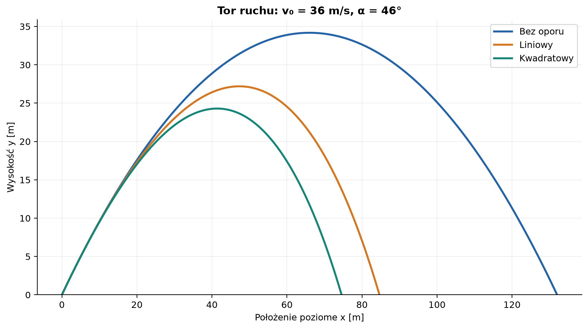
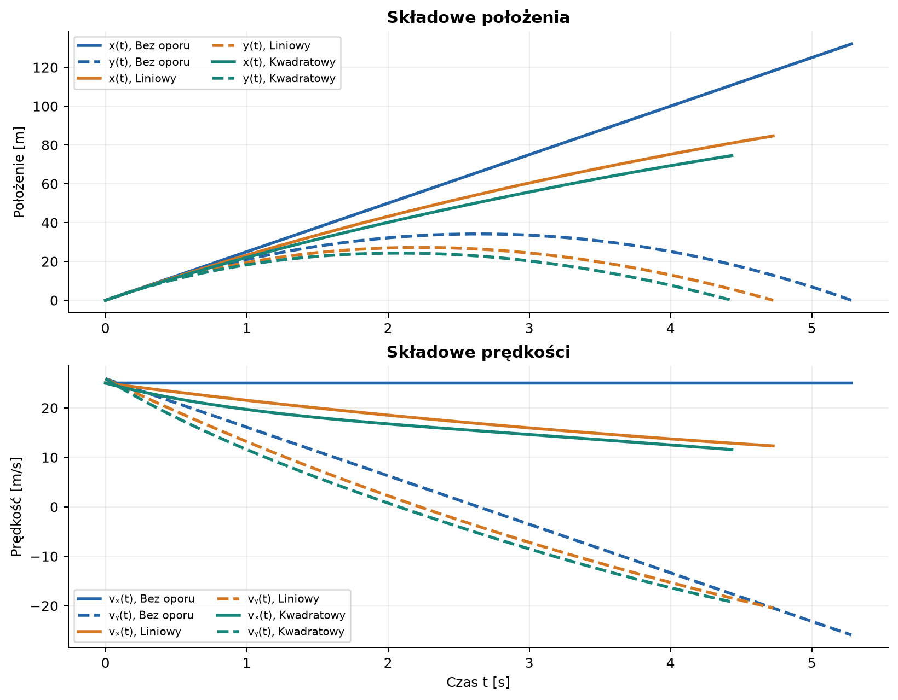
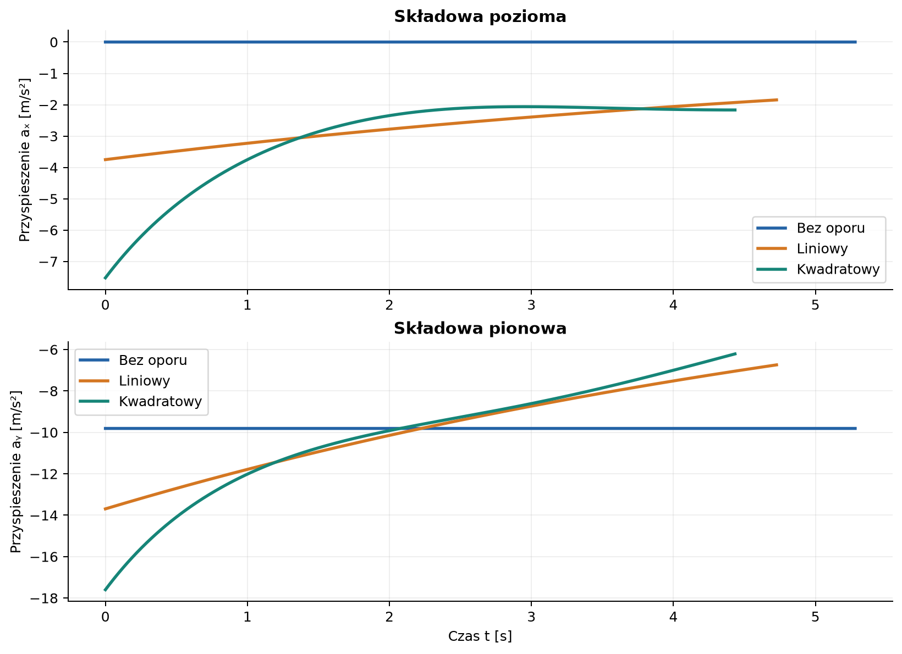
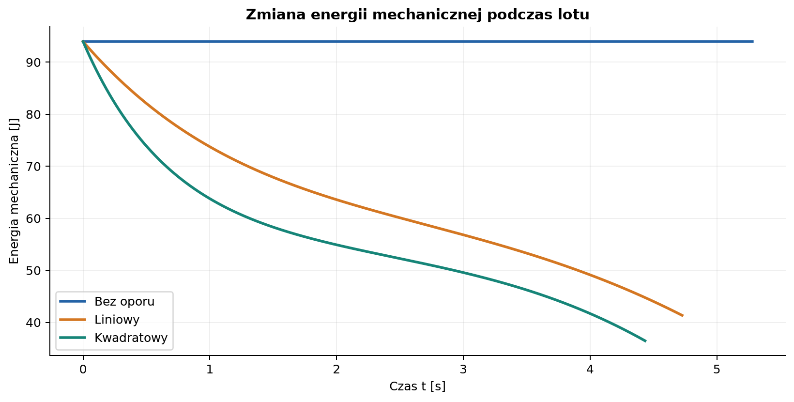

# Rzut ukośny — od modelu idealnego do oporu powietrza

*Raport obliczeniowy z wyprowadzeniem równań, porównaniem modeli i wykresami wygenerowanymi w Pythonie.*

**Temat:** ruch ciała wyrzuconego pod kątem do poziomu.  
**Metoda:** wyprowadzenie analityczne dla próżni oraz numeryczne rozwiązanie równań ruchu z oporem.  
**Dane początkowe:** $v_0=36\,\mathrm{m/s}$, $\alpha=46^\circ=0{,}803\,\mathrm{rad}$.  
**Charakter danych:** obliczenia modelowe, nie pomiary eksperymentalne.

## Spis treści

1. [Cel, układ współrzędnych i założenia](#1-cel-układ-współrzędnych-i-założenia)
2. [Rzut ukośny bez oporu powietrza](#2-rzut-ukośny-bez-oporu-powietrza)
3. [Opór powietrza](#3-opór-powietrza)
4. [Metoda numeryczna i kod](#4-metoda-numeryczna-i-kod)
5. [Wyniki i wykresy](#5-wyniki-i-wykresy)
6. [Ograniczenia modelu](#6-ograniczenia-modelu)
7. [Wnioski](#7-wnioski)

---

## 1. Cel, układ współrzędnych i założenia

Rzut ukośny jest ruchem w dwóch wymiarach. W modelu bez oporu składowa pozioma prędkości pozostaje stała, a składowa pionowa zmienia się pod wpływem grawitacji. Opór powietrza sprzęga oba kierunki: siła oporu jest przeciwnie skierowana do chwilowej prędkości.

Przyjmujemy początek układu współrzędnych w miejscu wyrzutu, oś $x$ poziomo w kierunku ruchu, a oś $y$ pionowo w górę. Ciało startuje z poziomu $y_0=0\,\mathrm{m}$ i ląduje na tym samym poziomie. Pomijamy wiatr, siłę wyporu, zmianę gęstości powietrza i zmianę $g$ z wysokością.

### 1.1. Dane i jednostki

| Symbol | Znaczenie | Wartość | Jednostka SI |
| :--- | :--- | ---: | :---: |
| $v_0$ | szybkość początkowa | $36{,}0$ | $\mathrm{m/s}$ |
| $\alpha$ | kąt wyrzutu | $46^\circ=0{,}803$ | $\mathrm{rad}$ |
| $g$ | przyspieszenie grawitacyjne | $9{,}81$ | $\mathrm{m/s^2}$ |
| $m$ | masa przykładowej kuli | $0{,}145$ | $\mathrm{kg}$ |
| $r$ | promień kuli | $0{,}0366$ | $\mathrm{m}$ |
| $\rho$ | gęstość powietrza | $1{,}225$ | $\mathrm{kg/m^3}$ |
| $C_D$ | współczynnik oporu kuli | $0{,}47$ | bez jednostki |
| $\beta$ | parametr oporu liniowego | $0{,}150$ | $\mathrm{s^{-1}}$ |

Kąt podano również w radianach, ponieważ funkcje trygonometryczne w równaniach i kodzie korzystają z tej jednostki. Pole przekroju kuli wynosi

$$
A=\pi r^2=4{,}208\cdot10^{-3}\,\mathrm{m^2}.
$$

## 2. Rzut ukośny bez oporu powietrza

### 2.1. Rozkład prędkości początkowej

Wektor prędkości początkowej rozkładamy na składową poziomą i pionową:

$$
v_{x0}=v_0\cos\alpha,\qquad
v_{y0}=v_0\sin\alpha.
$$

Dla przyjętych danych:

$$
v_{x0}=36\cos(46^\circ)=25{,}01\,\mathrm{m/s},\qquad
v_{y0}=36\sin(46^\circ)=25{,}90\,\mathrm{m/s}.
$$

### 2.2. Równania ruchu i ich rozwiązanie

Bez oporu jedyną siłą jest ciężar $\vec{F}_g=(0,-mg)$. Z drugiej zasady Newtona:

$$
m\ddot{x}=0,\qquad m\ddot{y}=-mg,
$$

czyli

$$
\ddot{x}=0,\qquad \ddot{y}=-g.
$$

Całkując równania i stosując warunki początkowe $x(0)=y(0)=0$, $\dot{x}(0)=v_0\cos\alpha$, $\dot{y}(0)=v_0\sin\alpha$, otrzymujemy:

$$
x(t)=v_0\cos\alpha\,t,\qquad
y(t)=v_0\sin\alpha\,t-\frac{1}{2}gt^2,
$$

$$
v_x(t)=v_0\cos\alpha,\qquad
v_y(t)=v_0\sin\alpha-gt.
$$

Po wyeliminowaniu czasu, $t=x/(v_0\cos\alpha)$, równanie toru ma postać paraboli:

$$
y(x)=x\tan\alpha-\frac{g x^2}{2v_0^2\cos^2\alpha}.
$$

### 2.3. Czas lotu, zasięg i wysokość maksymalna

Chwila lądowania spełnia $y(t)=0$. Oprócz rozwiązania $t=0$ dostajemy:

$$
T=\frac{2v_0\sin\alpha}{g}=5{,}280\,\mathrm{s}.
$$

Zasięg poziomy oraz wysokość maksymalna (osiągana, gdy $v_y=0$) wynoszą:

$$
R=v_0\cos\alpha\,T
 =\frac{v_0^2\sin(2\alpha)}{g}
 =132{,}03\,\mathrm{m},
$$

$$
t_{\mathrm{w}}=\frac{v_0\sin\alpha}{g}=2{,}640\,\mathrm{s},
\qquad
H=\frac{v_0^2\sin^2\alpha}{2g}=34{,}18\,\mathrm{m}.
$$

Przy równych wysokościach startu i lądowania największy zasięg w próżni występuje dla $\alpha=45^\circ$. Dla wybranego kąta $46^\circ$ wynik jest do tego maksimum zbliżony.

## 3. Opór powietrza

### 3.1. Opór liniowy

Prosty model oporu przyjmuje siłę proporcjonalną do prędkości:

$$
\vec{F}_{\mathrm{op}}=-b\vec{v},\qquad \beta=\frac{b}{m}.
$$

Wtedy równania ruchu rozdzielają się na osie:

$$
\dot{v}_x=-\beta v_x,\qquad
\dot{v}_y=-g-\beta v_y.
$$

Dla warunków początkowych z poprzedniej sekcji ich rozwiązania są następujące:

$$
v_x(t)=v_0\cos\alpha\,e^{-\beta t},
\qquad
x(t)=\frac{v_0\cos\alpha}{\beta}\left(1-e^{-\beta t}\right),
$$

$$
v_y(t)=\left(v_0\sin\alpha+\frac{g}{\beta}\right)e^{-\beta t}
-\frac{g}{\beta},
$$

$$
y(t)=\frac{v_0\sin\alpha+g/\beta}{\beta}
\left(1-e^{-\beta t}\right)-\frac{g}{\beta}t.
$$

Pionowa prędkość graniczna w tym modelu wynosi $-g/\beta$. Chwilę lądowania wyznacza się z równania $y(t)=0$ dla $t>0$; równanie zawierające składnik wykładniczy rozwiązujemy numerycznie. Model liniowy jest użytecznym przybliżeniem dla niewielkich prędkości, ale nie opisuje dobrze oporu kuli przy całym rozpatrywanym zakresie szybkości.

### 3.2. Opór kwadratowy

Dla obiektu poruszającego się w powietrzu często stosuje się opór proporcjonalny do kwadratu szybkości:

$$
\vec{F}_{\mathrm{op}}
=-\frac{1}{2}\rho C_D A\,|\vec{v}|\,\vec{v}.
$$

Wprowadzając

$$
k=\frac{\rho C_D A}{2m}=0{,}008355\,\mathrm{m^{-1}},
$$

oraz $|\vec{v}|=\sqrt{v_x^2+v_y^2}$, zapisujemy równania składowych:

$$
\dot{x}=v_x,\qquad \dot{y}=v_y,
$$

$$
\dot{v}_x=-k|\vec{v}|v_x,\qquad
\dot{v}_y=-g-k|\vec{v}|v_y.
$$

Szybkość $|\vec{v}|$ zależy jednocześnie od obu składowych, więc układ nie rozdziela się na dwa niezależne równania. Nie ma tu prostych wzorów elementarnych na cały tor i czas lotu; rozwiązanie obliczamy numerycznie. Wartość $C_D=0{,}47$ jest przybliżeniem dla kuli, a nie uniwersalną stałą dla wszystkich prędkości i warunków przepływu.

### 3.3. Dlaczego energia maleje?

Energia mechaniczna jest sumą energii kinetycznej i potencjalnej:

$$
E_m=\frac{1}{2}m(v_x^2+v_y^2)+mgy.
$$

Jej tempo zmiany jest równe mocy siły oporu. Dla oporu liniowego i kwadratowego:

$$
\frac{dE_m}{dt}=\vec{F}_{\mathrm{op}}\cdot\vec{v}
$$

Dla przyjętych modeli otrzymujemy:

$$
\frac{dE_m}{dt}=-m\beta|\vec{v}|^2
\qquad \text{(opór liniowy)},
$$

$$
\frac{dE_m}{dt}=-mk|\vec{v}|^3
\qquad \text{(opór kwadratowy)}.
$$

W obu modelach po prawej stronie otrzymujemy wartość niedodatnią. Energia mechaniczna układu maleje, ponieważ część energii jest rozpraszana w powietrzu.

## 4. Metoda numeryczna i kod

Każdy model zapisujemy jako układ równań pierwszego rzędu dla stanu $(x,y,v_x,v_y)$. Do całkowania używamy klasycznej metody Rungego–Kutty czwartego rzędu (RK4) ze stałym krokiem $\Delta t=0{,}002\,\mathrm{s}$. Symulacja kończy się przy pierwszym przejściu przez $y=0$ po starcie; położenie i czas lądowania są interpolowane między ostatnimi krokami.

Poniższy fragment pokazuje implementację kroku RK4 i przyspieszenia w modelu kwadratowym. **Kompletny, uruchamialny skrypt** z generowaniem wszystkich wykresów i kontrolą wyniku znajduje się w pliku [generuj_wykresy.py](./generuj_wykresy.py).

```python
def przyspieszenie(vx, vy, model):
    speed = np.hypot(vx, vy)
    if model == "Bez oporu":
        return 0.0, -G
    if model == "Liniowy":
        return -BETA * vx, -G - BETA * vy
    if model == "Kwadratowy":
        return -K_QUAD * speed * vx, -G - K_QUAD * speed * vy
    raise ValueError(f"Nieznany model oporu: {model}")


def pochodna(stan, model):
    x, y, vx, vy = stan
    ax, ay = przyspieszenie(vx, vy, model)
    return np.array([vx, vy, ax, ay], dtype=float)


def krok_rk4(stan, dt, model):
    k1 = pochodna(stan, model)
    k2 = pochodna(stan + 0.5 * dt * k1, model)
    k3 = pochodna(stan + 0.5 * dt * k2, model)
    k4 = pochodna(stan + dt * k3, model)
    return stan + (dt / 6.0) * (k1 + 2*k2 + 2*k3 + k4)
```

Aby odtworzyć wyniki, zainstaluj `numpy` i `matplotlib`, a następnie uruchom:

```bash
python generuj_wykresy.py
```

Skrypt zapisuje pliki PNG w `files/rzut_ukosny/`. Dla przypadku bez oporu porównuje obliczony czas lotu, zasięg i wysokość maksymalną ze wzorami analitycznymi.

## 5. Wyniki i wykresy

| Model | Czas lotu [s] | Zasięg [m] | Wysokość maksymalna [m] |
| :--- | ---: | ---: | ---: |
| Bez oporu | $5{,}280$ | $132{,}030$ | $34{,}180$ |
| Opór liniowy, $\beta=0{,}150\,\mathrm{s^{-1}}$ | $4{,}726$ | $84{,}660$ | $27{,}198$ |
| Opór kwadratowy, $k=0{,}008355\,\mathrm{m^{-1}}$ | $4{,}433$ | $74{,}566$ | $24{,}297$ |

W próżni ciało leci najdalej i najwyżej. W obu modelach oporu składowa pozioma prędkości maleje, a wysokość maksymalna i zasięg są mniejsze. Dla przyjętych parametrów kuli opór kwadratowy silniej skraca zasięg niż użyty model liniowy. Nie jest to uniwersalna kolejność dla dowolnego doboru parametrów — modele mają różne założenia.



*Rysunek 1. Tor w próżni jest parabolą. Opór zmienia tor i obniża jego wierzchołek oraz punkt lądowania.*



*Rysunek 2. Linie ciągłe oznaczają składowe poziome, przerywane — pionowe. W próżni $v_x$ jest stałe, a w modelach z oporem obie składowe prędkości są zmieniane przez siłę oporu.*



*Rysunek 3. W próżni $a_x=0$ i $a_y=-g$. Z oporem przyspieszenie zależy także od chwilowej prędkości.*



*Rysunek 4. W modelu bez oporu energia mechaniczna pozostaje stała. W modelach z oporem maleje wskutek pracy siły oporu.*

## 6. Ograniczenia modelu

- $g$ i gęstość powietrza są stałe na całym torze.
- Nie uwzględniamy wiatru, wyporu ani obrotu kuli (efektu Magnusa).
- Współczynnik $C_D$ zależy w rzeczywistości od kształtu, orientacji i warunków przepływu; przyjęta wartość jest uproszczeniem.
- Parametr liniowy $\beta$ został dobrany do porównania modeli i nie jest wyznaczony z eksperymentu dla tej konkretnej kuli.
- Wynik symulacji zależy od kroku czasowego. Skrypt dodatkowo sprawdza, czy rozwiązanie w próżni jest zgodne z niezależnym wynikiem analitycznym.

## 7. Wnioski

1. Rzut bez oporu składa się z ruchu jednostajnego poziomo i jednostajnie przyspieszonego pionowo, co daje paraboliczny tor.
2. Dla $v_0=36\,\mathrm{m/s}$ i $\alpha=46^\circ$ idealny zasięg wynosi około $132\,\mathrm{m}$, a wysokość maksymalna około $34{,}2\,\mathrm{m}$.
3. Opór zmniejsza prędkość poziomą, zasięg i wysokość maksymalną. Dla nieliniowego oporu zależnego od szybkości konieczne jest rozwiązanie numeryczne.
4. Zgodność symulacji bez oporu ze wzorami analitycznymi stanowi kontrolę poprawności implementacji i użytych jednostek.
